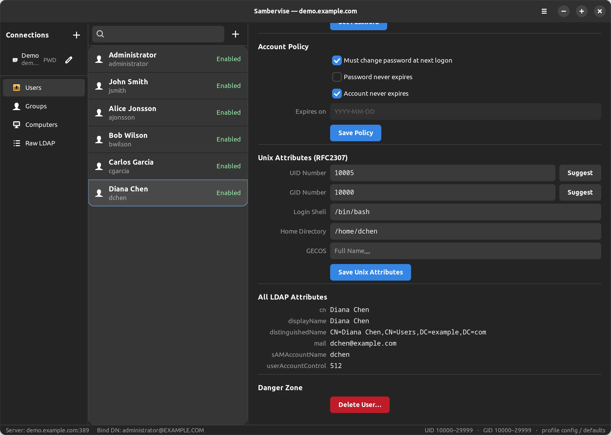

# Sambervise

A Linux GUI application for remotely administering Samba 4 Active Directory Domain Controllers.

Sambervise connects to remote DCs over LDAP/LDAPS. It has no effect on the local machine and requires no local elevated privileges.

## Features

- **User management** — browse users, edit names and contact details, enable/disable accounts, reset passwords, and configure password policy (force change at next logon, never expires, account expiry)
- **Group management** — browse groups, view membership, add and remove members
- **Computer management** — browse computer accounts, view OS info and Service Principal Names, edit description and DNS hostname, enable/disable accounts
- **Contact management** — browse, create, edit and delete mail-enabled contacts
- **OU management** — create, rename, move and delete organisational units, and move users, groups, computers and contacts between containers
- **Multiple connection profiles** — save and switch between named connections; profiles are stored in `~/.config/sambervise/connections.ini`
- **Authentication** — Kerberos/GSSAPI (uses existing `kinit` credentials) or simple bind with password
- **DC discovery** — finds Domain Controllers automatically via DNS SRV records (`_ldap._tcp.dc._msdcs.<domain>`)
- **TLS support** — LDAPS and STARTTLS

## Installing packages

Signed packages are published for Ubuntu 24.04 / Linux Mint 22, Debian 12 / LMDE 6,
Debian 13 / LMDE 7, AlmaLinux / RHEL 9 and 10, and Fedora (amd64 and arm64).
Add the package repository once:

```bash
curl -fsSL https://edward-murrell.github.io/packages/setup.sh | sudo sh
```

then install with:

```bash
sudo apt install sambervise     # Debian, Ubuntu, Mint
sudo dnf install sambervise     # Fedora, AlmaLinux, RHEL
```

Ubuntu 22.04 / Mint 21 are not supported: their libadwaita (1.1) is too old.

## Building from source

## Requirements

### Build dependencies

```
cmake >= 3.18
pkg-config
libgtk-4-dev
libadwaita-1-dev       (>= 1.2)
libldap-dev
```

On Debian/Ubuntu:

```bash
sudo apt install build-essential cmake ninja-build pkg-config \
    libgtk-4-dev libadwaita-1-dev libldap-dev
```

### Runtime dependencies

- `libsasl2-modules-gssapi-mit` — required for Kerberos authentication (usually already installed)
- A reachable Samba 4 AD DC

```bash
sudo apt install libsasl2-modules-gssapi-mit
```

## Building

```bash
cmake -B build -G Ninja
cmake --build build
```

To run from the source tree without installing:

```bash
GSETTINGS_SCHEMA_DIR=build/data ./build/src/sambervise
```

## Installing

```bash
sudo cmake --install build
```

This installs the binary, desktop entry, and GSettings schema, and recompiles the system schema cache automatically.

To install to a custom prefix (e.g. `/usr/local`):

```bash
cmake -B build -G Ninja -DCMAKE_INSTALL_PREFIX=/usr/local
cmake --build build
sudo cmake --install build
```

## Building distribution packages

Native packaging lives in `debian/` and `packaging/sambervise.spec`. Each
package is built on the release it targets, so library dependencies are
detected automatically. Run the build script as root inside a clean container
of the target release, from the repository root:

```bash
packaging/build-deb.sh 0.3.0    # -> out/sambervise_0.3.0+<codename>_<arch>.deb
packaging/build-rpm.sh 0.3.0    # -> out/sambervise-0.3.0-1.<dist>.<arch>.rpm
```

The Release workflow (`.github/workflows/release.yml`) does this for every
supported release on amd64 and arm64 when a `v*` tag is pushed.

## Screenshots



- [Users (detailed view)](docs/users2.webp)
- [Groups panel](docs/groups1.webp)
- [Computers panel](docs/computers1.webp)

## Kerberos authentication

For connections using Kerberos, obtain a ticket before launching Sambervise:

```bash
kinit administrator@EXAMPLE.COM
```

Sambervise will use the credential cache automatically. No password prompt is shown for Kerberos profiles.

## Running tests

```bash
ctest --test-dir build --output-on-failure
```

## License

GPL-3.0-or-later. See [COPYING](COPYING).
